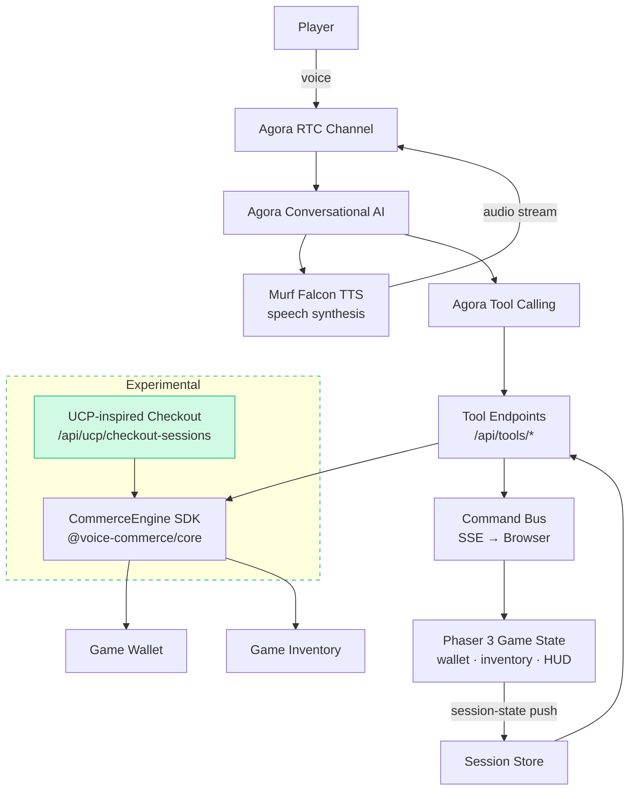

# VoiceStrike

### Play More. Click Less. Buy by Voice.

A voice-first commerce SDK for games — demonstrated through a Phaser 3 space shooter where players discover, compare, purchase, and equip weapons without leaving gameplay.

[](https://www.typescriptlang.org/)
[](https://phaser.io/)
[](https://www.agora.io/)
[](https://murf.ai/)
[](https://github.com/Universal-Commerce-Protocol/ucp)
[](./packages)

---

## The Problem

Traditional in-game purchasing interrupts the experience:

```
Pause gameplay → Open store → Browse items → Compare stats
→ Select item → Confirm purchase → Return to game → Equip
```

Each step is a context switch. Players who are engaged with active gameplay face a choice: break immersion to shop, or stay in the fight and skip the purchase entirely.

**VoiceStrike eliminates the navigation layer entirely:**

```
Keep playing → "Jarvis, buy the shotgun" → Weapon equipped
```

Voice authorization replaces menu navigation. The player stays in the game. The commerce engine handles the rest.

> The goal is zero shopping-menu clicks — not zero purchase authorization. Players still explicitly request what they want; they just do it by talking, not tapping.

---

## Live Demo

> 🎬 **Demo video coming soon** — placeholder for walkthrough GIF/video

### Voice Interactions

**Weapon discovery**
```
Player: "Jarvis, what weapons can I buy?"
Jarvis: "You have 400 coins. The Shotgun costs 300 — you can afford it.
         The Laser Gun costs 500 — you're 100 short."
```

**Tactical recommendation**
```
Player: "What would you recommend?"
Jarvis: "Five enemies incoming — the Shotgun's spread damage will help.
         Want me to grab it for you?"
```

**Purchase and equip**
```
Player: "Buy and equip the shotgun."
Jarvis: "Done — Shotgun equipped. 100 coins remaining. Good luck, Pilot."
```

**What happens under the hood:**
- Wallet deducted (300 coins → 100 coins remaining)
- Inventory updated (`ownedWeapons` gains `shotgun`)
- Weapon auto-equipped in Phaser game state
- Game loop continues uninterrupted

---

## Architecture



> **Note:** The UCP-inspired checkout adapter is an experimental parallel path. It is not yet connected to the Jarvis `purchase_weapon` tool — the active voice purchase flow goes through the Command Bus and SSE path shown above.

---

## UCP-Inspired Checkout (Experimental)

An isolated REST checkout adapter aligned with the [Universal Commerce Protocol](https://github.com/Universal-Commerce-Protocol/ucp) status lifecycle.

> **This is a UCP-inspired prototype, not a fully compliant UCP implementation.**
> Currency is game-coins (not ISO 4217), payment is a mock game-wallet, and the `incomplete` status is skipped since no external PSP escalation is needed.

### Endpoints

| Method | Path | Description |
|--------|------|-------------|
| `POST` | `/api/ucp/checkout-sessions` | Create a checkout session (`ready_for_complete`) |
| `GET` | `/api/ucp/checkout-sessions/:id` | Read session state |
| `POST` | `/api/ucp/checkout-sessions/:id/complete` | Authorize and execute purchase |
| `POST` | `/api/ucp/checkout-sessions/:id/cancel` | Cancel session |

### Status Lifecycle

```
ready_for_complete → complete_in_progress → completed
                                          ↘ canceled
```

### Example

```bash
# 1. Create a checkout session
curl -s -X POST http://localhost:3001/api/ucp/checkout-sessions \
  -H 'Content-Type: application/json' \
  -d '{"channel":"<game-channel>","item_ids":["shotgun"]}' | jq .

# Response includes all UCP required fields:
# { "ucp": {"version":"0.1"}, "id": "...", "status": "ready_for_complete",
#   "currency": "coins", "totals": {"subtotal":300,"tax":0,"grand_total":300}, ... }

# 2. Complete the purchase (idempotent — safe to retry)
curl -s -X POST http://localhost:3001/api/ucp/checkout-sessions/<id>/complete \
  -H 'Content-Type: application/json' \
  -d '{}' | jq .status
# → "completed"
```

**Idempotency:** Calling `/complete` on an already-completed session returns `200 completed` without re-charging. Backed by CommerceEngine's idempotency cache.

**Future goal:** Connect the UCP adapter to the Jarvis `purchase_weapon` tool so voice-initiated purchases go through a standardized, protocol-aligned checkout session.

---

## SDK Architecture

This repository is a monorepo demonstrating how the commerce SDK separates from any specific game or voice provider.

```
voice-commerce/
├── packages/
│   ├── core/                    # @voice-commerce/core
│   └── adapter-agora/           # @voice-commerce/adapter-agora
└── examples/
    └── voicestrike/
        ├── src/                 # @voice-commerce/voicestrike (browser)
        └── server/              # @voice-commerce/voicestrike-server
```

### `packages/core` — CommerceEngine SDK

Provider-agnostic commerce engine. No dependency on Agora, Phaser, or any specific game engine.

- `CommerceEngine` — purchase, equip, balance checks with full atomicity guarantees
- Idempotency cache (keyed by voice command ID — prevents duplicate transactions)
- Concurrency guard (single in-flight purchase)
- Rollback on inventory write failure (coins never silently lost)
- Typed event emitter (`purchase`, `walletChanged`, `equipped`)
- Adapter interfaces: `WalletAdapter`, `InventoryAdapter`, `EquipmentAdapter`

### `packages/adapter-agora` — Agora Voice Adapter

Bridges the Agora RTC/RTM SDK to the CommerceEngine interface.

- `AgoraVoiceAdapter` — connects, disconnects, manages voice state lifecycle
- Voice state machine: `idle → connecting → connected → listening/speaking → disconnecting`
- Proactive recommendation engine (fires only in `connected | listening | speaking` states)
- Write-token authenticated state pushes to backend

### `examples/voicestrike` — Phaser 3 Game (Browser)

Top-down space shooter demonstrating the full SDK integration.

- Wave-based enemy spawning with live difficulty scaling
- VoiceHUD overlay — transcripts, voice state, wallet balance
- Armory + Arsenal panels with real-time highlight commands from Jarvis
- Weapon catalogue: Pistol (free), Shotgun (300 coins), Laser Gun (500 coins)
- SSE command bus — backend pushes `purchase | equip | pause | resume | restart | stop` commands to the browser

### `examples/voicestrike/server` — Express Backend

Secure bridge between Agora cloud and the game state.

- Agora token generation (RTC + RTM)
- Agora Conversational AI agent lifecycle (invite, speak, stop)
- 8 tool endpoints called by Agora cloud: `list_available_weapons`, `get_player_status`, `purchase_weapon`, `equip_weapon`, `pause_game`, `resume_game`, `restart_game`, `stop_game`
- Write-token authorization (prevents external tool abuse)
- Session state store (game wallet + inventory, channel-keyed)
- UCP-inspired checkout router

---

## Key Features

| Feature | Status |
|---------|--------|
| Real-time conversational voice AI (Agora + Murf Falcon TTS) | ✅ Implemented |
| Contextual weapon recommendations (wave-aware proactive speaks) | ✅ Implemented |
| Voice-authorized purchases — no menu navigation | ✅ Implemented |
| Live wallet deduction and inventory updates | ✅ Implemented |
| Immediate weapon equipping via voice | ✅ Implemented |
| Secure tool calling (Bearer token, never in URL) | ✅ Implemented |
| Idempotent commerce operations (voice command dedup) | ✅ Implemented |
| Agent lifecycle health probe (5s FAILED detection) | ✅ Implemented |
| ErrConflict graceful handling (no 500s on agent death) | ✅ Implemented |
| UCP-inspired checkout session API | ✅ Experimental |
| UCP checkout connected to Jarvis purchase flow | 🔲 Roadmap |

---

## Getting Started

### Prerequisites

- Node.js 20+, npm 10+
- [Agora account](https://www.agora.io/) — App ID and App Certificate
- [Murf API key](https://murf.ai/) — Falcon TTS
- [cloudflared](https://developers.cloudflare.com/cloudflare-one/connections/connect-networks/downloads/) — exposes the local server to Agora cloud for tool calling

### Install

```bash
git clone https://github.com/kunal3108/gameplay_purchase.git
cd gameplay_purchase
npm install
```

### Configure

Create `examples/voicestrike/server/.env`:

```env
AGORA_APP_ID=your_agora_app_id
AGORA_APP_CERTIFICATE=your_agora_app_certificate
MURF_API_KEY=your_murf_api_key

# Generated automatically on first run — add here to persist across restarts
TOOL_SECRET=your_tool_secret

# Set after starting the Cloudflare tunnel (see below)
TOOL_BASE_URL=https://your-tunnel-subdomain.trycloudflare.com
```

### Run

**Terminal 1 — Cloudflare tunnel** (required for Agora cloud → tool endpoints):
```bash
npx cloudflared tunnel --url http://localhost:3001
# Copy the https://...trycloudflare.com URL into TOOL_BASE_URL in .env
```

**Terminal 2 — Backend server** (port 3001):
```bash
npm run dev:server
```

**Terminal 3 — Game** (port 5173):
```bash
npm run dev
```

Open `http://localhost:5173`, click **Start**, and say *"Jarvis, what can I buy?"*

---

## Testing

```bash
npm test          # run all 147 tests across all packages
```

**147 tests across 13 files:**

| Package | Tests |
|---------|-------|
| `packages/core` | 36 — CommerceEngine purchase, equip, idempotency, rollback |
| `packages/adapter-agora` | 11 — agent readiness state machine |
| `examples/voicestrike/server` | 100 — tools, lifecycle, session store, UCP checkout, agent lifecycle regression |

---

## Business Opportunity

Games lose purchases when shopping requires leaving the action. The pattern is not unique to shooters:

| Game Type | Voice Commerce Application |
|-----------|---------------------------|
| **Multiplayer shooters** | Buy ammo, weapons, or boosts mid-match |
| **Mobile RPGs** | Purchase potions, gear, or abilities during combat |
| **Battle royale** | Equip loadouts between rounds via voice |
| **Virtual worlds / metaverse** | Discover and purchase cosmetics in natural conversation |
| **Game marketplaces** | Browse and transact across titles through a persistent AI shopping assistant |

The `@voice-commerce/core` SDK is intentionally decoupled from Agora, Phaser, and VoiceStrike. Any game engine with a wallet and inventory can integrate it by implementing three lightweight adapter interfaces.

> **Hypothesis:** Reducing navigation steps in purchase flows may lower abandonment and increase conversion — particularly in high-engagement sessions where players are reluctant to context-switch. VoiceStrike is designed to test this hypothesis in a real game environment.

---

## Roadmap

- [ ] Connect Jarvis `purchase_weapon` tool to the UCP-inspired checkout adapter
- [ ] Improve alignment with the full UCP specification (ISO 4217 currency, PSP escalation, `links`)
- [ ] Measure purchase completion rates and player engagement vs. menu-based flows
- [ ] Support additional voice providers (beyond Agora)
- [ ] Support additional game engines (Unity, Godot)
- [ ] Add more commerce providers and payment authorization flows
- [ ] Multi-item cart support in a single voice transaction
- [ ] Production-grade payment authorization (non-mock wallet)

---

## Repository

```
packages/core                    Provider-agnostic CommerceEngine SDK
packages/adapter-agora           Agora voice adapter
examples/voicestrike             Phaser 3 demo game
examples/voicestrike/server      Express backend + tool endpoints + UCP checkout
```

---

> **VoiceStrike is the proof of concept. Voice Commerce is the platform.**

---

*Built with [Agora Conversational AI](https://www.agora.io/), [Murf Falcon TTS](https://murf.ai/), [Phaser 3](https://phaser.io/), and the [Universal Commerce Protocol](https://github.com/Universal-Commerce-Protocol/ucp) as inspiration.*
